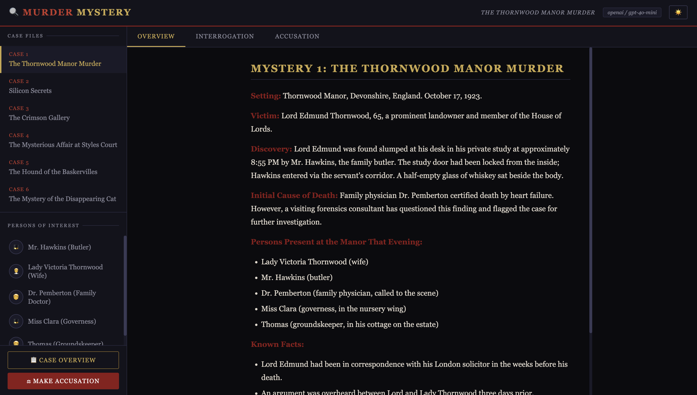
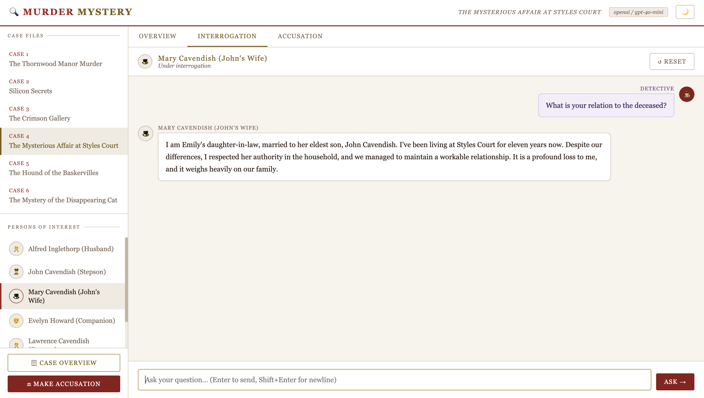

# 🔍 Murder Mystery Detective — RAG-Powered Interrogation Game

> *Six mysteries. Dozens of suspects. Every character only knows what they should.*


<p>
  
  
</p>





A fully playable murder mystery detective game where each suspect and witness is powered by their own **RAG (Retrieval-Augmented Generation) agent** with **role-based access control**. Play as the detective: question characters, gather clues, and make your accusation — all through a terminal CLI or a browser-based web UI.

Built to explore how RAG + RBAC + multi-provider LLM inference can create believable, knowledge-bounded AI characters.

---

## The Game

You are the detective. Choose a mystery, select a character to question, and interrogate them. Each character:

- **Only knows what they should know** — their knowledge is scoped to their own ChromaDB vector collection, enforced at the RBAC layer
- **Stays in character** — the LLM is grounded by a retrieved context window drawn exclusively from that character's documents
- **Has something to hide, or doesn't** — some are guilty and will deflect; others are witnesses who will open up under the right questioning
- **Remembers the conversation** — conversation history persists per character per session

When you're ready, make your accusation. The solution file reveals whether you were right.

---

## The Mysteries

| # | Mystery | Setting | Era |
|---|---------|---------|-----|
| 1 | **The Thornwood Manor Murder** | English country manor | 1923 |
| 2 | **Silicon Secrets** | Tech startup HQ | Present day |
| 3 | **The Crimson Gallery** | Art gallery gala | Present day |
| 4 | **The Styles Court Affair** | English country house | 1916 |
| 5 | **The Hound of the Baskervilles** | Dartmoor, Devon | 1889 |
| 6 | **The Disappearing Cat** | English country estate | 1920s |

Each mystery ships with: a case overview, 5–6 fully backstoried characters (with individual secrets, motives, and knowledge gaps), and a solution file.

---

## Architecture

```
┌─────────────────────────────────────────────────────────────┐
│                        Detective (You)                       │
└───────────────────────────┬─────────────────────────────────┘
                            │ question
                            ▼
┌─────────────────────────────────────────────────────────────┐
│                      CharacterAgent                          │
│                                                              │
│  1. RBAC check  ──► character can only touch own collection  │
│  2. RAG retrieval ─► top-k chunks from ChromaDB              │
│  3. LLM call ──────► grounded, in-character reply            │
│                                                              │
│  Providers: Ollama · OpenAI · Anthropic                      │
└─────────────────────────────────────────────────────────────┘
                            │
          ┌─────────────────┼─────────────────┐
          ▼                 ▼                 ▼
    RBAC Layer       ChromaDB             LLM Provider
  (per-character   (per-character       (ollama / openai
   collections)     isolation)           / anthropic)
```

### RAG Pipeline

Every character's knowledge base is chunked and embedded at setup time into their own isolated ChromaDB collection (`{mystery_id}__{character_id}`). At query time:

1. The detective's question is embedded and used to retrieve the **top-6 most relevant chunks** from that character's collection
2. Retrieved chunks are injected into the system prompt as the character's "active memory"
3. The LLM generates a reply grounded only in those chunks plus the character's hardcoded backstory

### RBAC

Role-Based Access Control is enforced at the vector store query layer. Each `CharacterRole` deterministically maps to exactly one ChromaDB collection name. The `RBAC` class validates every query before it reaches the store — a character physically cannot read another character's knowledge.

```python
# Collection name is derived deterministically from role identity
allowed_collection = f"{mystery_id}__{character_id}"
```

This means Lady Victoria cannot accidentally retrieve clues that only the groundskeeper observed, and the guilty CFO can't access the security guard's footage logs.

### Multi-Provider LLM

Switch between three inference backends with a single flag or environment variable:

| Provider | Flag | Best for |
|----------|------|----------|
| **Ollama** (default) | `--provider ollama` | Local, private, free |
| **OpenAI** | `--provider openai` | Speed + quality |
| **Anthropic** | `--provider anthropic` | Nuanced character voice |

---

## Quick Start

### Prerequisites

- Python 3.12+
- An LLM backend: [Ollama](https://ollama.com/) (local) **or** an OpenAI/Anthropic API key

### 1. Install dependencies

```bash
pip install -r requirements.txt
```

### 2. Configure your LLM provider

Copy `.env.example` to `.env` (or set environment variables directly):

```bash
# For Ollama (default — no API key needed)
LLM_PROVIDER=ollama
# OLLAMA_HOST=http://localhost:11434  # optional, default shown

# For OpenAI
LLM_PROVIDER=openai
OPENAI_API_KEY=sk-...

# For Anthropic
LLM_PROVIDER=anthropic
ANTHROPIC_API_KEY=sk-ant-...
```

### 3. Build the vector database

```bash
python setup_db.py
```

This chunks and embeds all character knowledge into ChromaDB (downloads the `all-MiniLM-L6-v2` embedding model ~90 MB on first run).

### 4. Play

**Terminal (CLI):**
```bash
python main.py
```

**Browser (Web UI):**
```bash
python server.py
# Open http://localhost:7777
```

---

## Docker

The included `docker-compose.yml` handles setup and serving in two stages:

```bash
# Set your provider + API key in .env, then:
docker compose up
# Open http://localhost:7777
```

The `setup` service runs `setup_db.py` once and exits; the `app` service starts after it completes. ChromaDB data is persisted in a named Docker volume.

To re-index (e.g. after adding a mystery):
```bash
docker compose run --rm setup
```

---

## Project Structure

```
murder-mysteries/
├── main.py                    # CLI game loop
├── server.py                  # FastAPI web server
├── setup_db.py                # Chunking + ChromaDB indexing
├── frontend/
│   └── index.html             # Single-page browser UI
├── rag/
│   ├── agent.py               # CharacterAgent — RAG + LLM pipeline
│   ├── vector_store.py        # ChromaDB wrapper
│   ├── rbac.py                # Role-based access control
│   ├── llm.py                 # Multi-provider LLM abstraction
│   └── chunkers.py            # Text chunking strategies
├── mystery_1_thornwood_manor/
│   ├── case_overview.md
│   ├── solution.md
│   └── characters/
│       ├── lady_victoria_thornwood.md
│       └── ...
├── mystery_2_velvet_curtain/
│   └── ...                    # Same structure for all 8 mysteries
├── chroma_db/                 # Generated by setup_db.py (gitignored)
├── Dockerfile
├── docker-compose.yml
└── requirements.txt
```

---

## Adding Your Own Mystery

1. Create a folder `mystery_N_your_title/`
2. Add `case_overview.md`, `solution.md`, and a `characters/` subfolder with one `.md` file per character
3. Register the mystery and its characters in `setup_db.py`
4. Add character backstories (the private, in-character knowledge) to the `BACKSTORIES` dict in `main.py`
5. Run `python setup_db.py` to index the new knowledge base

---

## Tech Stack

| Component | Technology |
|-----------|------------|
| Vector store | [ChromaDB](https://www.trychroma.com/) |
| Embeddings | `all-MiniLM-L6-v2` (sentence-transformers) |
| LLM providers | Ollama · OpenAI · Anthropic |
| Web framework | FastAPI + Uvicorn |
| Frontend | Vanilla HTML + CSS + JS |
| Terminal UI | Rich |
| Containerisation | Docker + Docker Compose |

---

## GitHub

> 🔗 **[github.com/your-username/murder-mysteries](#)** ← add your link here

---

*Built as a practical exploration of RAG system design, RBAC-enforced knowledge isolation, and multi-provider LLM inference — wrapped in something actually fun to use.*
